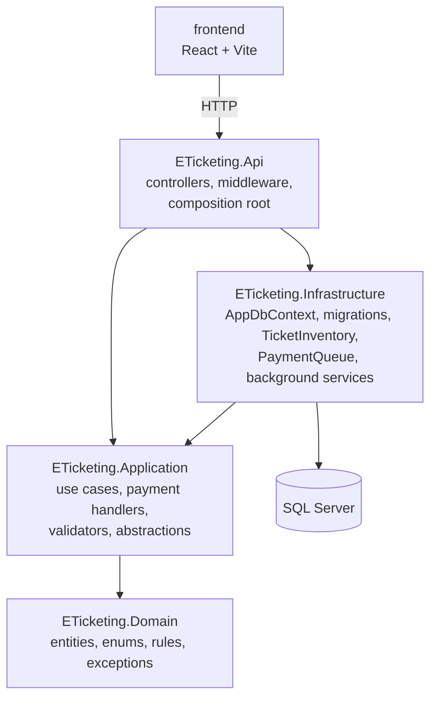
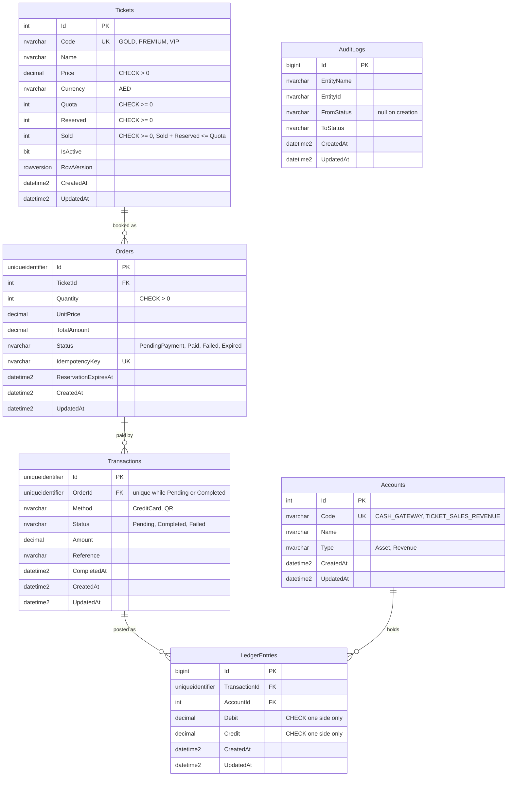
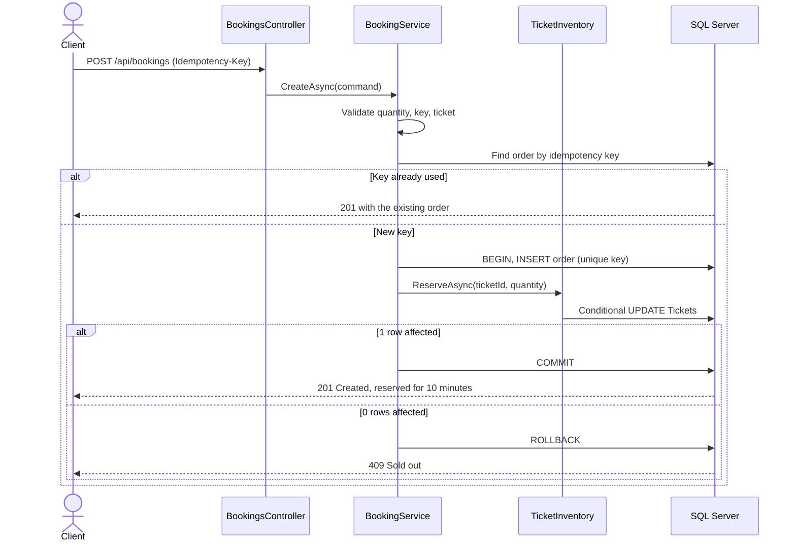
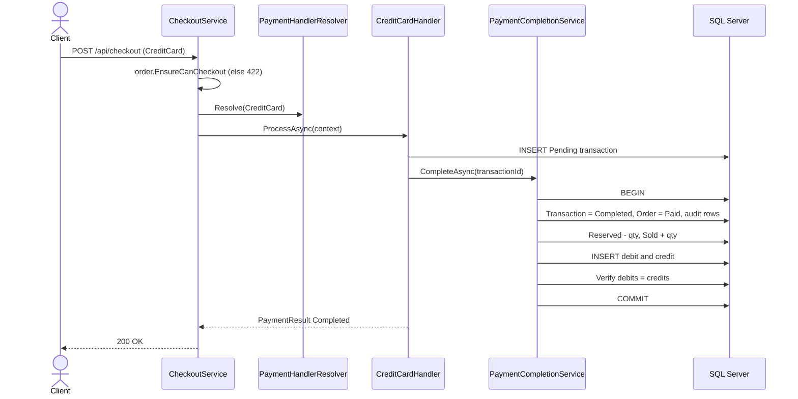
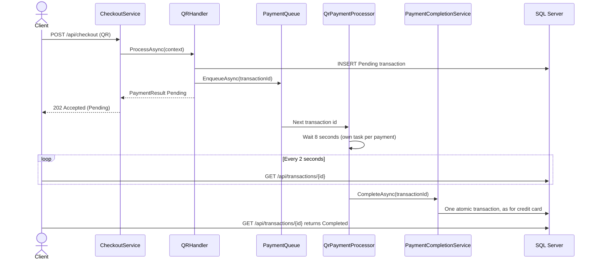

# E-Ticketing & Payment Simulation Platform

A ticket-sales backend with a small React frontend. Customers book Gold, Premium or VIP tickets and pay by credit card (instant) or QR (confirmed about 8 seconds later). The focus is data integrity: tickets are never oversold, and every payment is recorded in a double-entry ledger that always balances, even if the API crashes mid-payment.

**Stack:** .NET 8, ASP.NET Core Web API, EF Core 8, SQL Server 2022, FluentValidation, React + Vite + TypeScript, Docker, GitHub Actions. Tests use xUnit, FluentAssertions, Moq, Testcontainers and WebApplicationFactory.

## Contents

1. [Architecture](#1-architecture)
2. [Database design](#2-database-design)
3. [Logic flows](#3-logic-flows)
4. [How the ledger stays accurate if the API crashes](#4-how-the-ledger-stays-accurate-if-the-api-crashes-mid-transaction)
5. [Concurrency strategy](#5-concurrency-strategy-inventory-reservation-pattern)
6. [SOLID](#6-solid)
7. [Strategy pattern: how to add ApplePay](#7-strategy-pattern-and-openclosed-how-to-add-applepay-in-3-steps)
8. [Design decisions and trade-offs](#8-design-decisions-and-trade-offs)
9. [Setup, Swagger and tests](#9-setup-swagger-and-tests)

## 1. Architecture

A lightweight Clean Architecture in a modular monolith. Dependencies point inward: `Application` never references `Infrastructure`.



| Project | Responsibility |
|---|---|
| `ETicketing.Domain` | Entities, enums, state machines and domain exceptions. No dependencies. |
| `ETicketing.Application` | Use cases, DTOs, validators and all abstractions. Exposes `AddApplication()`. |
| `ETicketing.Infrastructure` | EF Core, stock updates, the Channel queue and background services. Exposes `AddInfrastructure(configuration)`. |
| `ETicketing.Api` | Controllers, exception middleware, Swagger, CORS, health check. `Program.cs` is the composition root. |

There is no MediatR, CQRS or generic repository. `IAppDbContext` already gives the use cases a testable persistence abstraction, so a repository layer would only add indirection. This is why `Application` references the EF Core package, but never a database provider or `Infrastructure`.

## 2. Database design

Every table has `CreatedAt` and `UpdatedAt` in UTC. Nothing is hard-deleted: `AppDbContext` rejects deletes, and it rejects updates to `LedgerEntries` and `AuditLogs`. Enums are stored as strings, money columns are `decimal(18,2)`, and every foreign key uses `Restrict`.



`AuditLogs` is deliberately not a foreign key: it records rows from two tables by name and id. `AppDbContext.SaveChangesAsync` writes an audit row for every Order and Transaction status change, in the same database transaction, so a use case cannot forget one.

Seed data: GOLD 100 AED (quota 100), PREMIUM 200 AED (quota 100), VIP 500 AED (quota 50), and the accounts `CASH_GATEWAY` and `TICKET_SALES_REVENUE`.

## 3. Logic flows

### Booking



### Credit card checkout



### QR checkout



**Why a BackgroundService instead of `await Task.Delay` in the request?** A request that waits 8 seconds holds a connection open, and the client can time out or disconnect with its payment left in an unknown state. Any crash would lose the work, because it would live only in that request. With a queue, the request returns 202 immediately and the database row is the durable record, so the wait can be resumed after a restart. Each payment also waits in its own task, so one QR never delays another.

## 4. How the ledger stays accurate if the API crashes mid-transaction

Four mechanisms work together:

1. **One database transaction.** `PaymentCompletionService.CompleteAsync` changes the transaction status, order status, stock and ledger entries inside a single `BeginTransactionAsync`. If the process dies before `COMMIT`, SQL Server rolls everything back. There is no state where stock moved but the ledger did not.
2. **Idempotent completion.** `CompleteAsync` returns immediately if the transaction is no longer Pending, so retries and recovery are safe. `Status` is also an EF concurrency token, so two simultaneous completions cannot both succeed: the loser's `UPDATE` matches 0 rows, it rolls back and re-reads the final status.
3. **Pending recovery on startup.** The queue is in memory, but it holds only ids. The truth is the Pending row in the database. When `QrPaymentProcessor` starts, it re-enqueues every Pending transaction.
4. **Reservation expiry.** `ReservationExpiryService` runs every minute. It marks unpaid orders past `ReservationExpiresAt` as Expired and releases their stock, so abandoned or crashed checkouts cannot hold tickets forever.

| Crash point | Result after restart |
|---|---|
| After booking, before checkout | Order stays reserved until it expires, then stock returns. |
| After the Pending row, before enqueue | Recovery finds the row and processes it. |
| During the 8-second wait | Recovery processes it again from the start. |
| Inside `CompleteAsync`, before commit | Rolled back to Pending, then recovery completes it. |
| After commit | Already Completed, so nothing is repeated. |

If a payment and the expiry job race for the same order, the concurrency token lets exactly one win. If expiry wins, the payment is marked Failed and neither stock nor ledger changes.

The ledger itself is protected at several levels: `RecordTicketSaleAsync` writes exactly one debit and one credit, `EnsureBalancedAsync` throws `UnbalancedLedgerException` before commit if they differ, a CHECK constraint forces each row to be one-sided, and `GET /api/ledger/balance` lets anyone verify the totals.

## 5. Concurrency strategy (Inventory Reservation Pattern)

Stock has three numbers, with `Available = Quota - Reserved - Sold`. Booking moves stock to Reserved, a completed payment moves it to Sold, and failure or expiry returns it.

Each `ITicketInventory` method is **one atomic conditional UPDATE**:

```sql
UPDATE Tickets
SET    Reserved = Reserved + @qty
WHERE  Id = @id AND IsActive = 1 AND Sold + Reserved + @qty <= Quota;
```

When two customers buy the last ticket in the same millisecond, SQL Server takes a row lock, so the updates run one after the other. The first affects 1 row. The second then re-evaluates the `WHERE` clause on the new value, affects 0 rows, and receives `409 Conflict`. The `Sold + Reserved <= Quota` CHECK constraint is a second guard if any other code ever gets this wrong.

**Why not optimistic concurrency with RowVersion and retries?**

| | Atomic conditional UPDATE | RowVersion and retry |
|---|---|---|
| Round trips | One statement | Read, then write, plus retries |
| Lost updates | Impossible: the check and the write are one operation | Prevented, but only if every writer follows the pattern |
| Under contention | Requests queue briefly on the row lock | Most requests fail and retry, which gets worse as load rises |
| Retry loop | None | Needs a limit, backoff and an exhausted-retries outcome |
| Guarantee | Enforced by the database | Depends on application code |

For a hot row like the last few tickets, contention is the normal case, which is exactly where optimistic retries behave worst. `Tickets.RowVersion` is kept for other kinds of update.

Two more races are closed by the database:

- **Double payment:** the filtered unique index `UX_Transactions_OrderId_Live` allows only one Pending or Completed transaction per order. A second checkout gets 409.
- **Duplicate booking:** `Orders.IdempotencyKey` is a unique index. The order is inserted *before* stock is reserved, so a concurrent retry waits on the index and receives the original order rather than a false sold-out on the last seat.

## 6. SOLID

**Single Responsibility.** Each class has one reason to change: `BookingService` creates orders and reserves stock, `CheckoutService` starts payments, `PaymentCompletionService` finalises them atomically, `LedgerService` only does double-entry bookkeeping, `TicketInventory` only moves stock, and `CreditCardHandler` and `QRHandler` each handle one payment method.

**Open/Closed.** The system is open to new payment methods and closed to modification. `CheckoutService` and `PaymentHandlerResolver` never name a concrete method: the resolver receives `IEnumerable<IPaymentHandler>` from DI. `OpenClosedPrincipleTests` proves this by registering a fake handler and running it through the unchanged `CheckoutService`.

**Liskov Substitution.** Every `IPaymentHandler` honours one contract: it returns a `PaymentResult`, reports expected failures as `Failed` instead of throwing, and respects the `CancellationToken`. `CheckoutService` treats instant and deferred handlers identically, and `PaymentHandlerContractTests` checks both.

**Interface Segregation.** Consumers depend on small, focused interfaces: `ITicketInventory`, `ILedgerService`, `IPaymentQueue`, `IPaymentCompletionService`, `IClock`. `QRHandler` needs a queue, so it sees `IPaymentQueue` and nothing about the ledger.

**Dependency Inversion.** `Application` defines the abstractions and `Infrastructure` implements them, for example `IAppDbContext` by `AppDbContext` and `IPaymentQueue` by `PaymentQueue`. Everything is wired by constructor injection through `AddApplication()` and `AddInfrastructure()`, and `Program.cs` is the composition root. Services are never created with `new`.

## 7. Strategy pattern and Open/Closed: how to add ApplePay in 3 steps

| Role | Type |
|---|---|
| Strategy | `IPaymentHandler` |
| Concrete strategies | `CreditCardHandler`, `QRHandler` |
| Context | `CheckoutService` |
| Factory | `PaymentHandlerResolver` |

**Step 1.** Add one enum value in `PaymentMethod`:

```csharp
ApplePay = 3
```

**Step 2.** Add one handler class:

```csharp
public sealed class ApplePayHandler(
    PendingTransactionCreator transactionCreator,
    IPaymentCompletionService completionService) : IPaymentHandler
{
    public PaymentMethod Method => PaymentMethod.ApplePay;

    public async Task<PaymentResult> ProcessAsync(PaymentContext context, CancellationToken cancellationToken)
    {
        var transaction = await transactionCreator.CreateAsync(context, Method, cancellationToken);
        if (transaction is null)
        {
            return PaymentResult.Failed(PaymentMessages.AlreadyInProgress);
        }

        var status = await completionService.CompleteAsync(transaction.Id, cancellationToken);

        return status == TransactionStatus.Completed
            ? PaymentResult.Completed(transaction)
            : PaymentResult.Failed(PaymentMessages.OrderNoLongerPayable, transaction);
    }
}
```

**Step 3.** Add one DI registration in `AddApplication()`:

```csharp
services.AddScoped<IPaymentHandler, ApplePayHandler>();
```

That is all. `CheckoutService`, the controllers, the resolver and the existing handlers do not change, and no migration is needed because enums are stored as strings.

## 8. Design decisions and trade-offs

| Decision | Why | Trade-off |
|---|---|---|
| Modular monolith | Simple to run and reason about at this scale. | Modules scale together. |
| `IAppDbContext` instead of repositories | Less code, and full LINQ in use cases. | `Application` depends on the EF Core package. |
| Use-case services injected as concrete classes | They have one implementation, so an interface would add nothing. Infrastructure boundaries still use interfaces. | Controllers are tested through integration tests. |
| In-process Channel queue | No broker needed, and the database keeps the queue recoverable. | Only suits a single API instance. |
| Status as a concurrency token on Orders and Transactions | Reuses an existing column, with no extra `RowVersion`. | Losers must handle a concurrency exception. |
| Auditing inside `SaveChangesAsync` | A status change cannot skip its audit row. | Bulk `ExecuteUpdate` bypasses it, so it is used for stock only. |
| Expiry can beat a slow QR payment | Stock rules stay simple, and integrity always holds. | A QR started in the last 8 seconds of a reservation can fail. |
| `EnableRetryOnFailure` is off | It conflicts with explicit transactions. Startup has its own retry. | Transient runtime errors surface instead of retrying. |
| `UpdatedAt` on insert-only tables | Keeps the "all tables" rule uniform. | On those tables it always equals `CreatedAt`. |

**What I would add for production:**

- **Outbox pattern** so that database changes and published events cannot drift apart.
- **A real message broker** (RabbitMQ, Azure Service Bus) instead of the Channel, with retries and a dead-letter queue, so several API instances can run.
- **Distributed locks** so that only one instance runs the expiry and recovery jobs.
- **Redis** to cache ticket availability for read-heavy traffic.
- **Observability** with OpenTelemetry traces, metrics and alerts, for example on ledger imbalance or an old Pending transaction.
- **Security:** authentication, rate limiting, and secrets in a vault rather than configuration.

## 9. Setup, Swagger and tests

**Prerequisite:** Docker Desktop. Then one command runs the database, API and frontend:

```bash
docker compose up --build
```

| Service | URL |
|---|---|
| Frontend | http://localhost:3000 |
| Swagger | http://localhost:8080/swagger |
| Health check | http://localhost:8080/health |
| SQL Server | `localhost,14333` |

Migrations and seed data are applied automatically on startup, with retries while SQL Server starts. The `SA_PASSWORD` environment variable overrides the default development password.

### API

| Method | Route | Result |
|---|---|---|
| GET | `/api/tickets` | Ticket types with stock |
| POST | `/api/bookings` | 201 with the order; requires the `Idempotency-Key` header |
| POST | `/api/checkout` | 200 for CreditCard, 202 for QR |
| GET | `/api/transactions/{id}` | Payment status |
| GET | `/api/orders/{id}` | Order summary |
| GET | `/api/ledger/balance` | Total debits, credits and account balances |
| GET | `/health` | Health check, including the database |

Errors use ProblemDetails: 400 validation, 404 not found, 409 sold out or conflict, 422 invalid state.

### Run without Docker for the API and frontend

Requires the .NET 8 SDK and Node.js.

```bash
docker compose up -d sqlserver
dotnet run --project src/ETicketing.Api      # http://localhost:5080/swagger
cd frontend && npm install && npm run dev    # http://localhost:5173
```

### Run the tests

```bash
dotnet test
```

The integration tests start a real SQL Server through Testcontainers, so Docker must be running. They cover 20 parallel bookings for the last ticket, the credit card and QR flows, idempotency, double checkout, reservation expiry and crash recovery. CI runs the same build and tests on every push and pull request.
